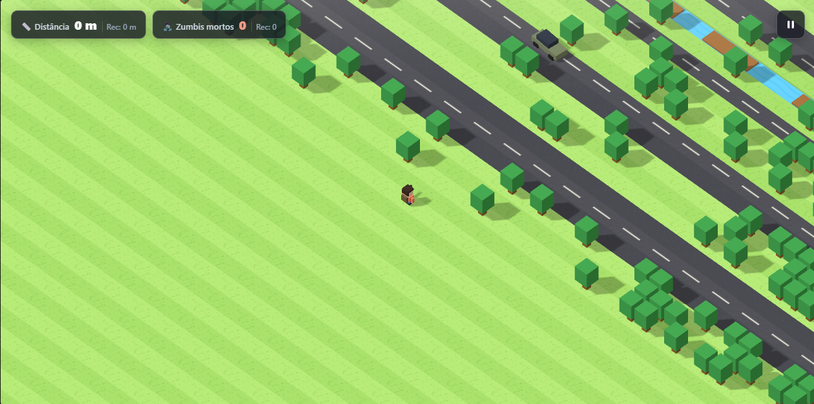
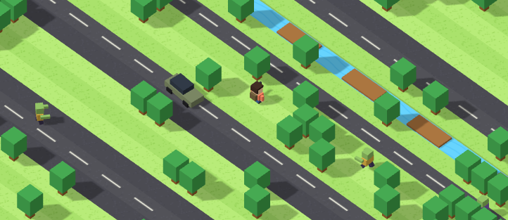
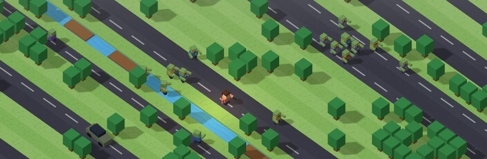
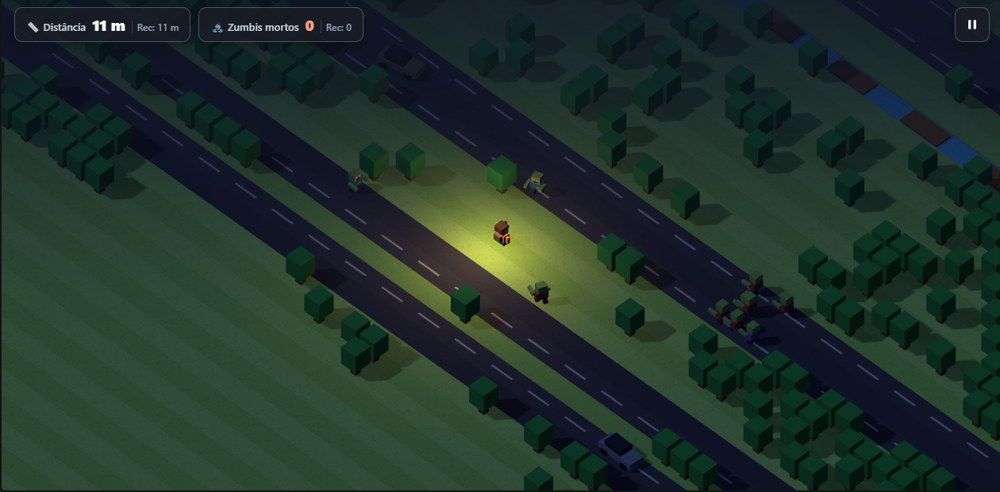
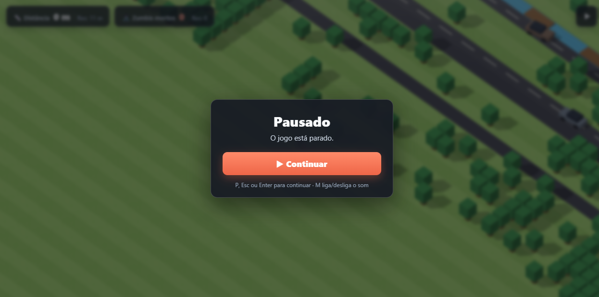
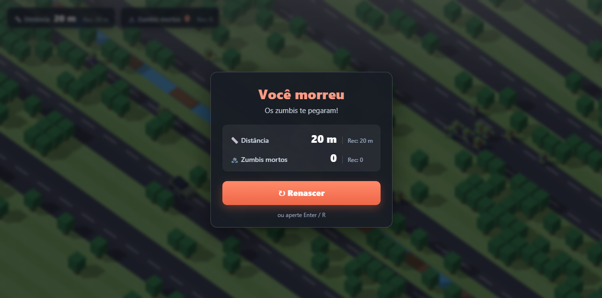

# Tiny Trails

Tiny Trails is a small 3D arcade hopping game made with Three.js for a bachelor "Game development" class. Guide a lone traveler across roads and moving river logs while zombies close in, shoot your way out, and try to beat your best distance and zombie count.

> Main reference: Crossy Road

> Tool used: **Three.js**

**Authors (A-z):** /
[Name | GitHub user]
1. Andrew Húngaro | andrewhungaro42_design
2. Felipe Augusto | felipesaugusto
3. Vinícius do Carmo Soares | ViniFunt
4. Vinícius Machado | viniciusmachadovianna

## About the game

### Story

A strange outbreak has emptied the countryside. You are a lone traveler with a backpack and an old pistol, trying to get as far away from the infected area as possible. There is no map and no safe place to stop: the zombies track you wherever you rest, wander across the roads in groups, and the rivers can only be crossed by hopping on floating logs. When night falls, the world goes dark and all you have is your lantern and the sound of crickets. How far can you go?

### Objectives

- Travel as far as you can. Distance is measured by the furthest row you have reached.
- Survive: you die if a zombie touches you, if you fall into the river, or if a log carries you out of the playable area.
- Kill as many zombies as possible with your pistol.
- Beat your own best distance and zombie count.

### Characters

- **The traveler:** the player, a blocky hero with a backpack and a pistol, who hops one tile at a time.
- **Chasers:** zombies that spawn around you and walk straight toward you.
- **Crossers:** zombies that walk across the roads, one by one or in hordes on wide roads.

### Scenarios

- **Grass:** open fields with trees that block your way (and your bullets).
- **Roads:** lanes with parked cars and zombies crossing from side to side.
- **Rivers:** water that kills on contact, crossed by moving logs that carry you sideways.
- **Day and night:** a cycle of about 100 seconds. At night the world gets dark and foggy, your lantern turns on, and crickets replace part of the daytime wind.

## Tool used

The game is built with **[Three.js](https://threejs.org/)** (WebGL) and bundled/served with **[Vite](https://vite.dev/)**. Three.js features used in the project:

- Orthographic camera that follows the player (isometric look).
- Hemisphere, directional and point lights with real-time shadow maps, plus fog for the day/night atmosphere.
- Instanced meshes for trees and logs, and merged geometries for characters and cars, to reduce draw calls.
- `Raycaster` for bullet hits, `Box3` for zombie collisions and `Points` for particle effects.
- `CanvasTexture` for procedurally drawn grass, road and water textures.
- `AudioListener` / `PositionalAudio` for sound that gets louder and pans as zombies get closer.

## How to install and run

Requirements: [Node.js](https://nodejs.org/) (current LTS version) and a modern browser with WebGL (Chrome, Edge, Firefox or Safari).

1. Clone the repository and enter its folder.
2. Install the project dependencies with `npm install`.
3. Start the development server with `npm run dev`.
4. Open the local URL printed by Vite in your browser (usually `http://localhost:5173`).

To generate the production build, run `npm run build`. The result is placed in the `dist` folder, and `npm run preview` serves it locally.

> Sound note: browsers only allow audio after the first key press or click on the page, so the sound starts as soon as you press a key.

### Core mechanics

- **Movement:** The player hops one grid tile per key press (forward, back, left, right). Holding forward or back keeps hopping. Trees and parked cars block the way.
- **Map generation:** Procedurally generated rows of grass (with trees), roads (with parked cars) and rivers (with moving logs). Rows are created ahead of the player and disposed of behind.
- **Water:** Landing on the river without a log under you ends the run. Logs carry you sideways, and being carried off the playable area also ends the run.
- **Zombies:** After your first hop, zombies start spawning around you and chase you (up to 12 at a time). Others walk across the roads, alone or in hordes on wide roads (three or more lanes). Touching any zombie ends the run.
- **Shooting:** Fire in the direction you are facing. Shots have a short cooldown and limited range, steer slightly toward zombies in front of you (light aim assist) and are stopped by trees and cars.
- **Camera:** Follows the player. You can only retreat up to 4 rows behind your furthest row.
- **Scoring:** Distance in meters (furthest row reached) and zombies killed. The HUD shows the current run and the best of the session. Records are kept in memory only, so they reset when the page is reloaded.

### Controls

| Input | Action |
| --- | --- |
| Arrow keys or WASD | Hop forward, backward, left or right |
| Space | Shoot in the direction the player is facing |
| P or Esc | Pause / resume (Enter also resumes) |
| Pause button (top-right corner) | Pause / resume with the mouse |
| Enter or R | Respawn after dying (or click the **Renascer** button) |
| M | Mute / unmute all sound |

### Pause and respawn

- **Pause:** Freezes the game and silences all sound, including the ambience. The game also pauses by itself when you switch tabs or minimize the window, so you never die while looking away.
- **Game over:** When a zombie catches you or you fall in the water, the game stops on a "You died" screen showing the cause, distance, zombies killed and the session records. A badge appears when you beat a previous record.
- **Respawn:** The **Renascer** button (or Enter / R) starts a new run from the beginning. It stays locked for a moment after death so keys still held down do not restart the game by accident.

### Audio

There are no audio files: every sound effect is synthesized in code with the Web Audio API (`sounds.js`).

- **Player:** hop and landing sounds (grass, road and log have their own variations), gunshot with echo, pause / resume blips and a respawn chime.
- **Zombies:** growls, wet hit sounds and a bite on game over. Zombie sounds are positional, so they get louder and pan as zombies get closer.
- **World:** bullets hitting trees (leaves) or parked cars (metal clank), water splash, plus wind and crickets that change with the time of day.
- **Game over:** a short sad jingle after the death sound, and a bright arpeggio when a record is beaten.
- **Mix:** a compressor keeps overlapping sounds from clipping, and the ambience gets quieter on the game over screen.
- **Loading:** sounds are generated in small steps after the page loads so the game does not freeze. A sound that is not ready yet simply does not play.

### Project structure

| File | Role |
| --- | --- |
| `main.js` | Game loop, input, game states (playing / paused / dead), camera |
| `world.js` | Procedural rows: grass, roads, rivers, trees, logs and parked cars |
| `zombies.js` | Zombie models, spawning (chasers, crossers and hordes), movement and collisions |
| `bullets.js` | Shooting, aim assist and bullet collisions |
| `player.js` | Player model |
| `lighting.js` | Day/night cycle, lantern and muzzle flash |
| `particles.js` | Particle effects |
| `sounds.js` | Procedural sound effects and ambience |
| `hud.js` | HUD, messages, pause button and pause / game over screen |
| `merge.js` | Helper that merges box geometries to reduce draw calls |
| `style.css` | Styles for the HUD, pause button and screens |

### Performance notes

- Adaptive resolution: if the average frame rate drops, the render resolution is lowered step by step (set `ADAPTIVE_RESOLUTION` to `false` in `main.js` to disable it).
- Trees and logs use instanced meshes, and models are merged into single geometries to reduce draw calls.
- While paused, the scene is not re-rendered, which saves battery.
- Shadow quality can be lowered with `SHADOW_MAP_SIZE` in `lighting.js` on weaker GPUs.

# Demonstrations and deploy

## Screenshots and GIFs

## Screenshots and GIFs

## Playable version

> **TODO (before delivery):** publish the game and put the link here: `https://<github-user>.github.io/<repository-name>/`

To publish on GitHub Pages:

1. In `vite.config.js`, set `base: "/<repository-name>/"`.
2. Run `npm run build`.
3. Publish the `dist` folder with GitHub Pages (repository **Settings → Pages**, for example using a GitHub Actions workflow).

## Credits

- Inspired by [Crossy Road](https://www.crossyroad.com/) (Hipster Whale).
- Made with [Three.js](https://threejs.org/) and [Vite](https://vite.dev/).
- All models, textures and sound effects are generated by our own code: the game does not load external image, model or audio files.
