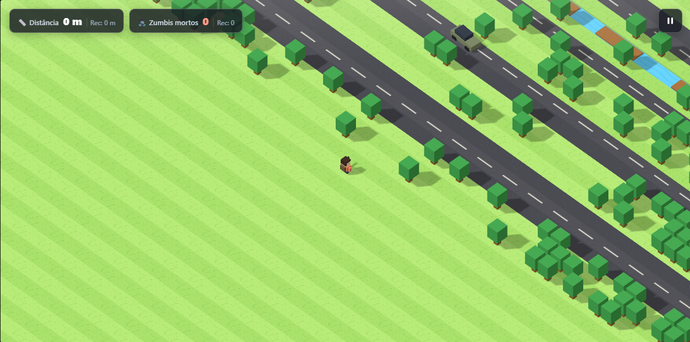
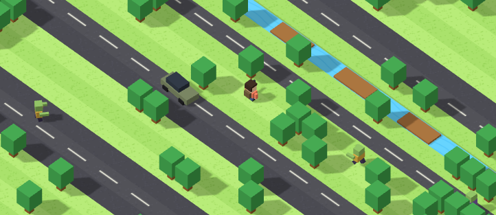
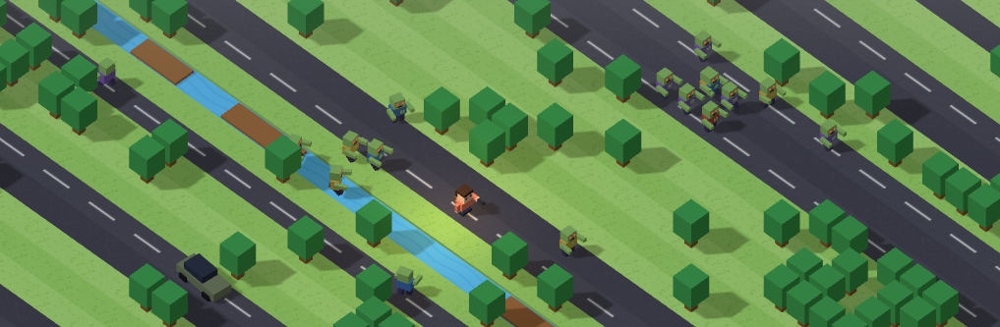
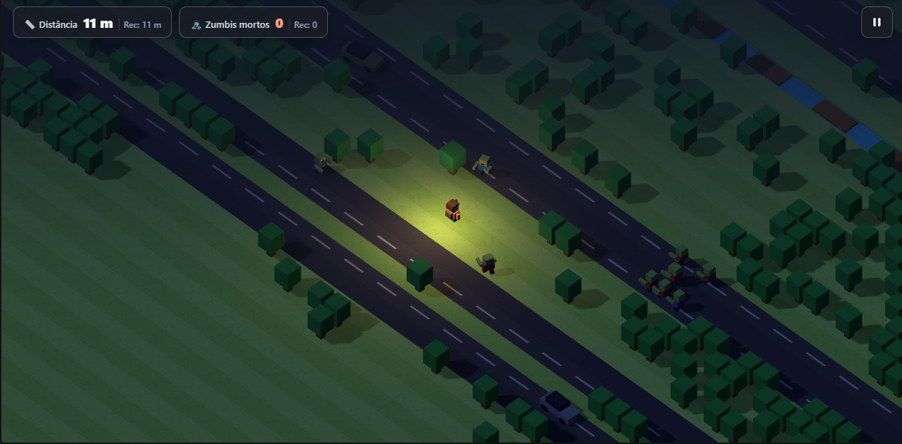
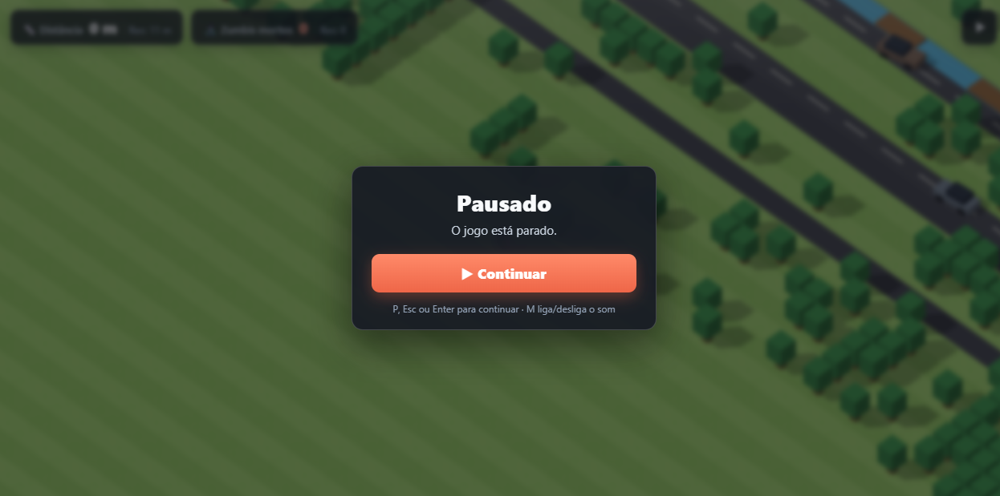
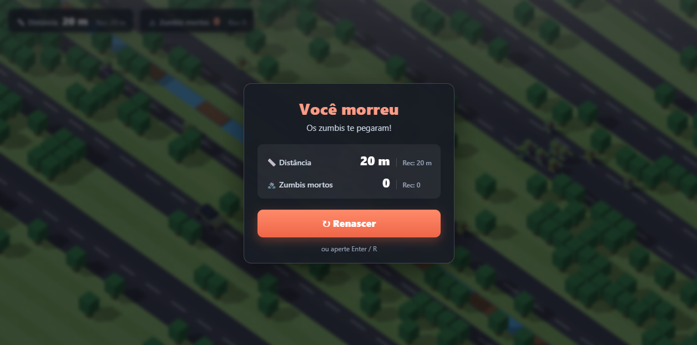

# Tiny Trails

Tiny Trails é um jogo arcade 3D de sobrevivência infinita feito em Three.js para um projeto acadêmico de desenvolvimento de jogos. Atravesse estradas e rios enquanto zumbis te caçam, tentando ir o mais longe possível.

> **Referência principal:** Crossy Roads 
> **Tecnologias:** Three.js e Vite

## Integrantes

1. Andrew Húngaro — [andrewhungaro42_design](https://github.com/andrewhungaro42_design)
2. Felipe Augusto — [felipesaugusto](https://github.com/felipesaugusto)
3. Vinícius do Carmo Soares — [ViniFunt](https://github.com/ViniFunt)
4. Vinícius Machado — [viniciusmachadovianna](https://github.com/viniciusmachadovianna)

## Sobre o jogo

Um surto misterioso tomou conta do interior. Você precisa escapar sozinho da região infectada carregando somente uma mochila e um revólver. Zumbis te seguem incançavelmente, atravessam as estradas em grupos e os rios só podem ser cruzados saltando sobre troncos. Quando anoitece, a escuridão e a neblina tornam a jornada ainda mais perigosa.

### Objetivos

- Percorra a maior distância possível; a pontuação considera o ponto mais distante alcançado.
- Sobreviva aos zumbis e atravesse os rios usando os troncos.
- Elimine zumbis com sua arma e tente bater recordes da partida.

### Cenários e inimigos

- **Campos:** árvores bloqueiam o caminho e tiros.
- **Estradas:** carros estacionados e zumbis que atravessam sozinhos ou em hordas.
- **Rios:** a água é fatal; use os troncos em movimento para atravessar.
- **Ciclo de dia e noite:** a iluminação, a neblina e a ambientação sonora mudam ao longo do tempo.
- **Perseguidores:** zumbis que aparecem nas proximidades e seguem o jogador.

## Como jogar

| Tecla ou controle | Ação |
| --- | --- |
| Setas ou WASD | Saltar para frente, para trás ou para os lados |
| Espaço | Atirar na direção para a qual o personagem está virado |
| P ou Esc | Pausar ou continuar |
| Enter | Continuar após pausar ou renascer depois de morrer |
| R | Renascer depois de morrer |
| Botão de pausa na tela | Pausar ou continuar com o mouse |
| M | Ativar ou desativar o som |

O jogador avança um espaço por tecla pressionada. Manter as teclas de avanço ou recuo pressionadas repete os saltos. Árvores e carros bloqueiam o caminho. É possível recuar até quatro linhas atrás do ponto mais distante alcançado.

Ao cair na água ou ser alcançado por um zumbi, a partida termina. A tela final mostra a causa, a distância e os zumbis eliminados. Os recordes são mantidos apenas durante a sessão e são apagados ao recarregar a página.

## Instalação e execução

Requisitos: Node.js e um navegador moderno com suporte a WebGL.

1. Clone este repositório e entre na pasta do projeto.
2. Instale as dependências:

   ```bash
   npm install
   ```

3. Inicie o servidor de desenvolvimento:

   ```bash
   npm run dev
   ```

4. Abra no navegador o endereço local informado pelo Vite (normalmente `http://localhost:5173`).

Para gerar e testar a versão de produção:

```bash
npm run build
npm run preview
```

O build é gerado na pasta `dist`. O navegador só permite iniciar o áudio após uma interação do usuário, como pressionar uma tecla ou clicar na página.

## Tecnologias e implementação

- **Three.js:** renderização 3D com câmera ortográfica, iluminação, sombras e neblina.
- **Vite:** servidor de desenvolvimento e empacotamento da aplicação.
- **Geração procedural:** cenários, texturas, modelos e efeitos sonoros são criados pelo próprio código.
- **Desempenho:** árvores e troncos usam instâncias de malha; algumas geometrias são combinadas para reduzir chamadas de desenho. A resolução pode diminuir automaticamente em dispositivos com baixo desempenho.
- **Áudio:** efeitos e ambientação são sintetizados com a Web Audio API. Sons de zumbis usam áudio posicional.

## Estrutura do projeto

| Arquivo | Responsabilidade |
| --- | --- |
| `src/main.js` | Loop do jogo, controles, câmera e estados da partida |
| `src/world.js` | Geração das linhas de campo, estrada e rio |
| `src/zombies.js` | Zumbis, perseguição, hordas e colisões |
| `src/bullets.js` | Disparos, assistência de mira e colisões |
| `src/player.js` | Modelo do personagem |
| `src/lighting.js` | Ciclo de dia e noite, lanterna e clarão dos disparos |
| `src/particles.js` | Efeitos de partículas |
| `src/sounds.js` | Efeitos sonoros e ambientação |
| `src/hud.js` | Interface, mensagens, pausa e tela de fim de jogo |
| `src/merge.js` | Utilitário para combinar geometrias |
| `src/style.css` | Estilos da interface |

## Imagens








## Publicação

Para publicar no GitHub Pages em um endereço de projeto, configure o caminho-base do Vite como `/<nome-do-repositorio>/` em `vite.config.js`, gere o build com `npm run build` e publique a pasta `dist` nas configurações de Pages do repositório. Para hospedar na raiz de um domínio, o caminho-base pode permanecer `/`.

- Modelos, texturas e efeitos sonoros são gerados pelo código do projeto; não são carregados arquivos externos de imagem, modelo ou áudio.
